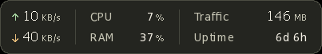
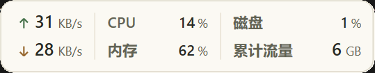
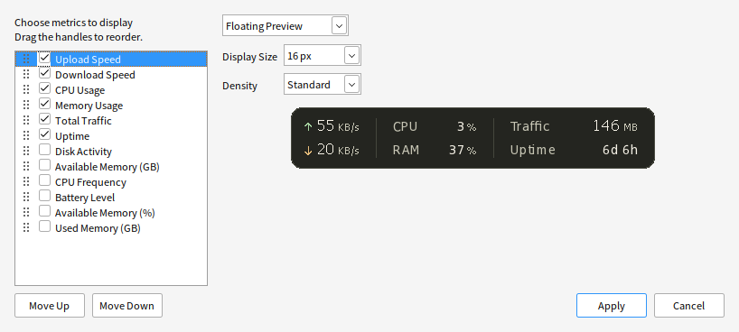

# windows-monitor-x

**English** · [简体中文](README.zh-CN.md)

Keep live network speeds, CPU and memory use, disk activity, and traffic totals visible in a floating panel or in the Windows taskbar. Choose which metrics to show and arrange them to fit your desktop.

[Download for Windows x64](https://github.com/Fracizz/windows-monitor-x/releases/latest) · [Quick start](#quick-start) · [Metrics](#metrics)



## Quick start

1. Download and run `windows-monitor-x.exe` on 64-bit Windows 10 version 1703 or later, or Windows 11. The app runs as your Windows user and opens a separate manager window for live readings and settings.
2. Closing the manager keeps monitoring active. To reopen it, run the executable again or choose **Open Manager** from the tray or panel context menu. Drag the floating panel to move it and snap it to screen edges. Click the tray icon to show or hide it.
3. In the manager, click **Edit Metrics**. Choose metrics, drag to reorder them, and click **Apply** when you are happy with the preview.

## Usage

- **Floating or taskbar layout.** Enable **Embed in Taskbar** and choose **Left** or **Right** in **Settings → Taskbar Position**. Right is the default and uses the space between the app buttons and the notification area. The panel floats when the selected position has too little space, or when the taskbar auto-hides or is vertical.
- **Appearance.** In **Edit Metrics**, preview both layouts, choose a density, and set the display size from 10 to 24 px (16 px by default, scaled by Windows DPI). Both layouts share these settings. Turn **Bold Labels** off for regular-weight labels, or select the **Transparent** theme to let the taskbar's light or dark setting determine text and divider colours.
- **Refresh and sign-in.** The default refresh interval is one second. You can choose two, three, or five seconds, set the panel to stay on top, or enable **Run at Sign-in** to start monitoring when your Windows user signs in. Update the startup path through the same setting if you move the executable. Use the manager to reset total traffic or exit the app.
- **Export monitoring records.** Turn on **Record History** in the manager to collect samples at the current refresh interval. Recording is off by default. Choose **Export** in the manager or use the context menu to save the last seven days of available samples as JSON (column names and units listed once, one array per sample) or CSV (opens directly in spreadsheet apps). Pick the format with the file type or extension. Pausing recording or restarting the app preserves unexpired samples.
- **Language.** Choose English, Simplified Chinese, or **Use System Language** in **Settings → Language** (设置 → 语言). The default follows Windows. Changes take effect immediately and are saved.
- **Version and updates.** Use **About** to see the version or visit GitHub. **Settings → Check for Updates** verifies the SHA-256 of the release download before replacing the executable and restarting. The executable's directory must be writable.

## Screenshots

**Floating panel in the light theme (Simplified Chinese)**



**Metrics editor**



## Metrics

- By default, the panel displays upload and download speeds, CPU and memory usage, disk activity, and total network traffic. You can also enable available memory as a percentage, available and used memory in GB, current CPU frequency, system uptime, and battery level. Disk activity is the percentage of time the busiest physical disk is active. A dash indicates that a battery reading or other sample is unavailable.
- **Disk Read Speed** and **Disk Write Speed** show the combined throughput of all physical disks. **VRAM Usage (%)** and **Used VRAM (GB)** show dedicated memory usage across graphics adapters with valid readings. Enable each of these optional metrics in **Edit Metrics**.
- Percentages and transfer rates are displayed as integers. Physical memory and VRAM in GB (1 GB = 1 billion bytes) and current CPU frequency in GHz are displayed with two decimal places. The panel labels both CPU usage and frequency as `CPU`, with `%` for usage and `GHz` for frequency. Both layouts use the same metrics, order, and display size, with items arranged from top to bottom in each column.
- Network speeds aggregate traffic from active physical Ethernet and Wi-Fi adapters, including local network traffic. Total traffic counts bytes uploaded and downloaded while the app is running and is saved in `%LOCALAPPDATA%\WindowsMonitor\state.ini`.

## Packaging

On Windows, build with Rust, MSVC Build Tools, and the Windows SDK.

```powershell
.\scripts\package.ps1
```

The script puts the executable in `dist` as `<repository-name>-x.exe`. The executable's product name, file description, and tray name use the same name without the file extension. The name comes from the Git `origin` remote when available or the local repository directory otherwise. Source archives use the Cargo package name. An existing `-x` or `-X` suffix is normalized to a single lowercase `-x`.

## Verification

```powershell
cargo test --locked
cargo test --locked -- --ignored --nocapture
.\scripts\smoke.ps1 -Exe .\dist\windows-monitor-x.exe
```

System sampling tests require enabled physical disk performance counters. The smoke test requires a signed-in Windows desktop session and covers floating panel dimensions, common menu actions, single-instance behavior, settings persistence, and resource usage.

With the desktop unlocked and enough space on the primary horizontal taskbar, use the following command to verify that the panel can embed, restore its embedded position after a restart, and return to floating mode.

```powershell
.\scripts\smoke.ps1 -Exe .\dist\windows-monitor-x.exe -RequireTaskbar
```
