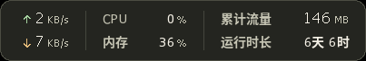
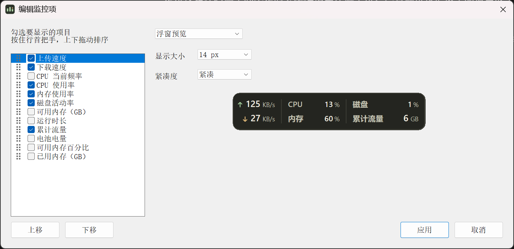

# windows-monitor-x

[English](README.md) · **简体中文**

把实时网速、CPU、内存、磁盘活动和累计流量放在 Windows 浮窗或任务栏里。可自行选择指标、调整顺序和字号。

[下载 Windows x64 版](https://github.com/Fracizz/windows-monitor-x/releases/latest) · [快速开始](#快速开始) · [监控指标](#监控指标)



## 快速开始

1. 下载并运行 `windows-monitor-x.exe`。支持 Windows 10 1703 及以上和 Windows 11 x64，使用当前用户权限。
2. 浮窗默认出现在主屏工作区右下角，可以拖动并吸附到屏幕边缘。单击托盘图标可显示或隐藏面板。
3. 右键浮窗或托盘图标，选择 **编辑监控项**。勾选指标、拖动排序，在预览中确认效果后点击 **应用**。

## 使用方法

- **浮窗或任务栏。** 开启 **嵌入任务栏**，在设置中选择靠左或靠右，默认靠右。主屏任务栏为竖排、自动隐藏或空间不足时，面板回到浮窗模式。
- **外观。** 监控项编辑器可设置紧凑度和 10–24 px 的字号，默认 16 px，随 Windows DPI 缩放。两种布局可即时预览，设置共用。可在设置中关闭默认开启的 **标签加粗**，或选用 **透明** 主题，让文字和竖线随任务栏明暗调整。
- **刷新与自启。** 默认每秒刷新，可改为 2、3 或 5 秒，也可开启 **窗口置顶**。打开 **开机自启** 后，当前用户登录时自动启动。移动 EXE 后可用同一设置更新启动路径。右键菜单还可以清零累计流量或退出。
- **语言。** 在 **设置 → 语言** 中可选简体中文、English 或跟随系统。默认跟随系统，切换后立即生效并保存。
- **版本与更新。** 打开 **关于** 可查看版本和访问 GitHub。通过 **设置 → 检查更新** 安装最新版，程序会校验下载文件的 SHA-256 并重启。更新需要 EXE 所在目录的写权限。

## 界面截图



## 监控指标

- 默认显示上传、下载、CPU 使用率、内存使用率、磁盘活动率和累计流量。可另外启用可用内存百分比、可用内存容量、已用内存容量、CPU 当前频率、系统运行时长和电池电量。磁盘活动率显示最忙物理磁盘的活动时间比例。电池或其他采样数据不可用时显示破折号。
- 百分比和网速等显示整数，物理内存容量以 GB 显示两位小数（1 GB = 10 亿字节），CPU 当前频率以 GHz 显示两位小数。浮窗和任务栏共用显示项、顺序和大小，每列从上到下排列。
- 网速汇总在线的物理以太网和 Wi-Fi 网卡，包含局域网流量。总流量按工具运行期间的上传与下载累计，保存在 `%LOCALAPPDATA%\WindowsMonitor\state.ini`。

## 打包

Windows 上使用 Rust、MSVC Build Tools 和 Windows SDK。

```powershell
.\scripts\package.ps1
```

打包脚本在 `dist` 生成「仓库名-x.exe」，EXE 的产品名称、文件描述和托盘名称使用同一名称。名称优先取 Git 的 `origin` 仓库名，没有远程时取本地仓库名。源码归档使用 Cargo 包名。仓库名已有 `-x` 或 `-X` 时统一为一个小写 `-x` 后缀。

## 验证

```powershell
cargo test --locked
cargo test --locked -- --ignored --nocapture
.\scripts\smoke.ps1 -Exe .\dist\windows-monitor-x.exe
```

系统采样测试需要已启用的物理磁盘计数器。桌面冒烟测试需要登录到 Windows 桌面，覆盖浮窗尺寸、常用菜单操作、单实例、设置持久化与资源占用。

桌面解锁且主屏水平任务栏有足够空位时，可运行以下命令验证嵌入、重启恢复和退出嵌入。

```powershell
.\scripts\smoke.ps1 -Exe .\dist\windows-monitor-x.exe -RequireTaskbar
```
